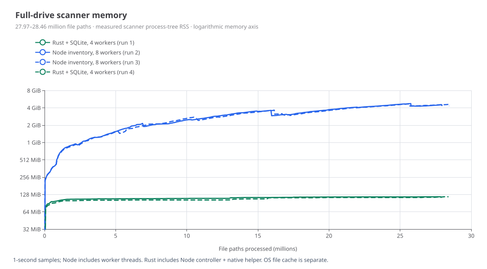

# Disk crawler spike

An isolated alternative to `DiskScanner`, created after a drive scan exhausted
the Node heap at roughly 28 million file paths. The crawler is now an opt-in
**experimental** backend in the app and CLI; Node remains the default. The app
uses `packages/whyfull/src/sqlite-scanner.ts` and `sqlite-inventory.ts`, with stored
subtree totals and bounded viewer queries. Raw benchmark databases use the older
spike schema and are not directly opened by the app.

The important change is keeping the inventory **on disk**. Rewriting the same
retained tree in Rust would reduce object overhead but still grow with the tree.

## What runs

```text
Node controller ──spawns──> Rust worker pool
       │                  streaming directory entries + lstat
       │ <──NDJSON pipe──  completed folders + hard-link candidates + progress
       ▼
SQLite directory inventory + unique hard-link ledger
       │
       └── paginated inspection / recursive size queries
```

- Rust streams directory entries instead of collecting entire listings. A
  shared queue holds at most 256 directories by default. When full, workers
  continue with local streaming DFS rather than blocking on an overflowing queue.
- Each folder retains only its largest 32 direct regular files. Names and parent
  IDs are persisted; full paths and child arrays are not repeated in every row.
- Hard-link candidates stream to a SQLite unique index. There is no global
  in-memory inode set. All file paths count as files; bytes and apparent bytes of
  a multiply linked inode count once. Its owning folder can vary with scheduling,
  as in the existing scanner.
- The pipe provides backpressure. The consumer processes bounded chunks and
  commits every 256 records or when a received record crosses the one-second
  checkpoint interval. SQLite uses an 8 MiB page cache and disk temporary storage.
- Completed folder records survive helper failure. Graceful cancellation marks
  them `cancelled`; helper/protocol errors mark them `failed`. A killed controller
  can leave `scanning` metadata and the last committed WAL batches. Keep the DB
  and its sidecars together until SQLite recovers them. Unfinished folders are
  absent, and work inside an unfinished folder is not checkpointed as a folder.
- Symlinks are skipped, different filesystems are excluded, `.whyfull` is pruned,
  and explicit directory exclusions use path components. No file contents are
  opened. Allocated bytes use Unix `blocks * 512`, matching the current scanner;
  directory-entry blocks and APFS shared clone extents are not accounted for.
- `node-stream` is a one-worker `opendirSync` control with the same SQLite
  consumer. It measures how much the inventory design helps without Rust.

Crawler memory depends on queue size, worker count, active DFS depth, path/name
lengths, and top-file limit rather than total completed directories or hard-linked
inodes. This is not a hard whole-machine RAM cap: Node/SQLite allocators, thread
stacks, open directory iterators, and the OS filesystem cache also cost resources.

## Run

Requires Node 22.18+ with `node:sqlite`, Cargo/Rust (tested with 1.90), and macOS or
Linux. SQLite still emits an experimental-feature warning in Node 22. Both application scanners now require Node 22.18+ and use this shared SQLite storage design.

From the repository root:

```sh
cargo build --release --locked --manifest-path experiments/disk-crawler/Cargo.toml
pnpm exec turbo build --filter=whyfull
node --test experiments/disk-crawler/test.mjs
cargo test --locked --manifest-path experiments/disk-crawler/Cargo.toml
cargo clippy --locked --manifest-path experiments/disk-crawler/Cargo.toml -- -D warnings

node --max-old-space-size=64 experiments/disk-crawler/scan.mjs /path/to/folder /tmp/new-scan.sqlite --workers 4
node experiments/disk-crawler/inspect.mjs /tmp/new-scan.sqlite
node experiments/disk-crawler/inspect.mjs /tmp/new-scan.sqlite 123 50
```

The output must be a **new** file outside the scan root (or inside a pruned
`.whyfull` folder). The parent directory must exist. Files are created with mode 0600. Options include `--exclude /absolute/path`, `--top-files 0..1000`,
`--queue-limit 1..65536`, and `--engine node-stream --workers 1`. Ctrl-C preserves
a partial database. An incomplete scan is inspectable, not resumable.

`inspect.mjs` returns direct files and a bounded page of child folders, computing
subtree totals inside SQLite. It does not rebuild a full tree in JS. Recursive
queries still cost time proportional to the queried subtree and would need
persisted aggregate totals for an interactive production viewer.

## Reproduce the comparison

```sh
node experiments/disk-crawler/fixture.mjs /tmp/new-crawler-fixture 20000
node experiments/disk-crawler/benchmark.mjs /tmp/new-crawler-fixture /tmp/new-results.json --rounds 3
node experiments/disk-crawler/benchmark.mjs /tmp/new-crawler-fixture /tmp/new-small-heap-results.json --rounds 1 --heap-mib 32
node experiments/disk-crawler/benchmark.mjs /path/to/unchanged/real/folder /tmp/new-real-results.json --rounds 3
```

The synthetic workload has 190,001 regular file paths (10,001 names of one
hard-linked inode), 20,002 folders, one symlink cycle, and one 1 GiB apparent-size
sparse file. Most files are empty, so it exercises metadata and inventory growth
without allocating hundreds of MiB of file contents. It represents neither a
full drive nor a typical mix of large files.

Each configuration runs in a fresh process with a 512 MiB Node old-space cap by
default, after an untimed warmup. Three rounds rotate/alternate execution order.
Successful results must match warmup counts, allocated and apparent bytes,
symlinks, issues, and excluded-folder counts. Failures are recorded and later
cases still run; the harness exits nonzero for any failure or discrepancy. Raw
results are saved after every case. Scratch databases are removed afterward.

Wall time includes process startup, scanning, SQLite writes and final checkpoint
for streaming cases. The existing scanner only builds an in-memory snapshot;
its export time is not included. CPU time sums user and system CPU across worker
threads and, for Rust, both processes. RSS comes from OS high-water marks rather
than a timer that might miss peaks. Rust's reported memory is the **sum of Node
and Rust peaks**, a conservative upper bound, not a simultaneous measurement.
OS filesystem cache and total machine memory pressure are not measured. These
are warm-cache observations on a live machine; no caches are purged or drives
rescanned automatically.

## Measured results, November 21, 2026

Apple M4 Pro, 12 logical CPUs, 48 GiB RAM, macOS 24.6.0, Node 22.23.2,
Rust 1.90 release build. The baseline was rebuilt from the existing working tree.
Three-round medians on the synthetic workload described above:

| Strategy                                | Workers | Wall time, including startup | Peak RSS / upper bound | CPU time |
| --------------------------------------- | ------: | ---------------------------: | ---------------------: | -------: |
| Existing Node inventory, sync metadata  |       1 |                      1.962 s |              150.0 MiB |  2.107 s |
| Existing Node inventory, sync metadata  |       4 |                      0.892 s |              182.0 MiB |  2.410 s |
| Existing Node inventory, async metadata |       4 |                      1.332 s |              203.5 MiB |  6.102 s |
| Streaming Node + SQLite                 |       1 |                      2.691 s |               80.3 MiB |  2.125 s |
| Streaming Rust + Node/SQLite            |       1 |                      1.593 s |               74.4 MiB |  2.012 s |
| Streaming Rust + Node/SQLite            |       4 |                      0.731 s |               76.5 MiB |  2.264 s |
| Streaming Rust + Node/SQLite            |       8 |                      0.732 s |               78.2 MiB |  2.809 s |

All 21 runs matched the same 190,001 file paths, 20,002 directories, 327,680
allocated bytes, 1,073,742,535 apparent bytes, one skipped symlink, and zero
issues. Four-worker Rust used **58% less process memory**, finished **18% sooner**,
and used about **6% less CPU** than four-worker sync Node in these observations,
while also persisting the inventory. Rust's crawler itself peaked around 2.4 MiB;
the controller/SQLite accounts for most of the combined figure. Databases were
about 8.2 MiB. See [all raw synthetic runs](results/synthetic.json).

The Node streaming control substantially reduced memory too, while adding time.
That supports making disk-backed inventory the first architectural change.
Four Rust workers are the better starting budget here: eight did not improve
median time and consumed about 24% more CPU. This is a local observation, not a
universal optimum or proof of full-drive scaling on HDDs, network storage, or
different directory shapes.

A separate [32 MiB old-space trial](results/synthetic-heap32.json) completed all
four streaming cases with matching totals; the existing four-worker sync case
aborted with a V8 heap OOM. The existing one-worker and async cases completed,
with much higher CPU time than at the normal heap cap. This is an isolate heap
limit, **not** a total process memory cap. The first attempt at this trial also
encountered transient `ENOSPC` writing its report; the saved trial is a subsequent
complete rerun. The harness now saves updates through temporary files and atomic
renames so a failed write does not truncate the previous report. Disk-backed
inventory needs free space and its output can be placed on another volume.

On this repository's unchanged dependency tree (27,206 file paths, 4,013 folders,
1,329 skipped symlinks, about 688 MiB allocated), all 21 runs also agreed:

| Strategy                       | Workers | Median wall time | Peak RSS / upper bound | CPU time |
| ------------------------------ | ------: | ---------------: | ---------------------: | -------: |
| Existing Node inventory, sync  |       1 |          0.563 s |               96.5 MiB |  0.631 s |
| Existing Node inventory, sync  |       4 |          0.277 s |              127.9 MiB |  0.877 s |
| Existing Node inventory, async |       4 |          0.393 s |              130.1 MiB |  1.528 s |
| Streaming Node + SQLite        |       1 |          0.483 s |               67.6 MiB |  0.514 s |
| Streaming Rust + Node/SQLite   |       1 |          0.358 s |               60.8 MiB |  0.457 s |
| Streaming Rust + Node/SQLite   |       4 |          0.159 s |               60.5 MiB |  0.570 s |
| Streaming Rust + Node/SQLite   |       8 |          0.170 s |               60.9 MiB |  0.720 s |

Four-worker Rust finished **43% sooner**, used **53% less process memory**, and
used **35% less CPU** than four-worker sync Node on this smaller real tree.
The persisted database was about 1.5 MiB. See [raw dependency-tree runs](results/dependencies.json).
These smaller workloads motivated the full-drive validation below. They used
the first helper version; the full-drive results use the corrected native
directory iterator described below.

## Full Data-volume comparison, November 21, 2026

Two runs per configuration, in **Rust 4 → Node 8 → Node 8 → Rust 4** order on
`/System/Volumes/Data`, the internal 4 TB APFS volume that exhausted the original
heap. Eight workers is the current app default. Both controllers used Node
22.23.2 with a 12 GiB old-space limit, top-files=32, no custom exclusions, and the
same filesystem access. Both scanners prune `.whyfull` and other mounts.
No app integration was made.

| Run | Scanner         | File paths | Time to persisted inventory | Peak RSS / upper bound |   CPU time |
| --- | --------------- | ---------: | --------------------------: | ---------------------: | ---------: |
| 1   | Rust, 4 workers | 27,974,630 |                   256.979 s |             116.64 MiB |   533.42 s |
| 2   | Node, 8 workers | 27,976,164 |                   340.212 s |           4,846.28 MiB |   990.38 s |
| 3   | Node, 8 workers | 28,463,365 |                   321.089 s |           4,847.55 MiB | 1,001.64 s |
| 4   | Rust, 4 workers | 28,463,507 |                   243.771 s |             116.89 MiB |   528.25 s |

Comparing the two-run means, Rust used about **24% less elapsed time**, **47% less
CPU time**, and **97.6% less peak process RSS** (about **41.5× lower**). The speed
benefit is moderate; the memory benefit is much larger. This measures the whole
alternative pipeline, including disk-backed inventory, not Rust alone. It does
not measure the browser or total desktop-app memory.

An earlier single four-worker Node reference took 502.164 seconds (including
18.805 seconds to export), peaked at 4.47 GiB RSS, and counted 28,226,202 file
paths. It is retained in the raw report for worker-budget context, but is outside
the balanced corrected sequence and excluded from its averages.

Node's crawl times were 326.576 and 306.387 seconds, followed by JSON exports of
12.997 and 14.111 seconds. Rust's SQLite writes happen during crawling and its
final checkpoint is included. The durable inventories were approximately
1.42–1.45 GiB for Rust and 2.30–2.35 GiB for Node. Every process was fresh; no
scans overlapped. The process tree was sampled once a second, and final OS
high-water marks include Node workers and both Rust-pipeline processes.



The adjacent pairs provide the useful coverage check:

- First pair: 1,534 file paths apart (0.0055%), 247 directories apart, and 21.4 MiB
  allocated-byte difference across about 4 TB.
- Last pair: 142 file paths apart (0.00050%), 53 directories apart, and 3.27 MiB
  allocated-byte difference. Both had four excluded directories.
- The error-directory audit matched all 415 Rust directories with issues to
  their Node counterparts; 388 were unreadable in both. No files were found
  hidden behind a Rust-only unreadable directory. Overall issue counts were
  442 for Rust and 445/449 for Node; exact parity is not claimed on a live volume.

The volume gained roughly **489,000 file paths between the two adjacent pairs**.
The machine remained in use, with changing load and existing swap. Caches were
not purged. A superseded exploratory export was unlinked during the first
corrected Node run to recover disk space; that maintenance may also affect its
time. The second Node pass had no such maintenance. These observations establish
the memory behavior on the large drive; two repetitions on a changing machine
do not establish an exact general speedup or cold-cache performance.

Full-drive testing also exposed an `EINTR` handling bug in the initial helper.
Rust 1.90's [directory iterator implementation](https://github.com/rust-lang/rust/blob/1.90.0/library/std/src/sys/fs/unix.rs#L650)
ends iteration after an enumeration error, so calling `next()` again does not
recover the remainder. The helper now owns a native cursor (`readdir_r` on macOS,
`readdir` on Linux), retries interrupted reads, opens and metadata calls, and
records retry counts. A fault-injection regression test verifies no entries are
lost or duplicated after a mid-directory interruption. An initial sequence was
stopped for investigation and excluded from the table. Neither corrected Rust
pass encountered an interruption; both reported zero retries. The initial four
explicitly interrupted directories only accounted for two files, so the larger
early count discrepancy was not attributed to those errors.

Artifacts: [raw report and coverage summary](results/full-drive.json),
[1-second memory samples](results/full-drive-memory.csv),
[memory chart](results/full-drive-memory.svg).

To reproduce explicitly, use a new output directory under `.whyfull`:

```sh
mkdir -p .whyfull
node experiments/disk-crawler/drive-benchmark.mjs /System/Volumes/Data .whyfull/new-drive-comparison --app-comparison
```

The default sequence also includes two four-worker Node runs. The harness
retains the latest successful inventory per engine, logs partial failures,
records swap/load and binary hashes, and checks available space before each run.
For retained files, audit coverage with
`verify-coverage.mjs NODE_JSON RUST_SQLITE NEW_PRIVATE_OUTPUT_JSON`. Publish only
the summary; the details contain private folder paths.

## Open-source approaches investigated

| Project                                                                                                                           | Useful approach                                                                                  | Fit here                                                                                                                                                                                                                                                               |
| --------------------------------------------------------------------------------------------------------------------------------- | ------------------------------------------------------------------------------------------------ | ---------------------------------------------------------------------------------------------------------------------------------------------------------------------------------------------------------------------------------------------------------------------- |
| [diskus](https://github.com/sharkdp/diskus) ([walker](https://github.com/sharkdp/diskus/blob/master/src/walk.rs), MIT/Apache-2.0) | Rayon traversal, channel-based aggregation, configurable worker count                            | Good total-size reference and library candidate; totals alone do not supply the folder inventory and retained largest files. Its current walker collects child paths and keeps an inode set, so it is not a direct implementation of this memory bound.                |
| [dua / dua-core](https://github.com/Byron/dua-cli) ([core API](https://docs.rs/dua-core/latest/dua_core/), MIT)                   | Work stealing, streaming traversal, platform-specific metadata acquisition, configurable descent | Strong next library candidate. The core documents native metadata from macOS/Windows directory enumeration, which could avoid the per-file metadata syscall used by this spike. Verify its buffering bounds and match our byte/exclusion semantics before adopting it. |
| [dust](https://github.com/bootandy/dust) ([walker](https://github.com/bootandy/dust/blob/master/src/dir_walker.rs), Apache-2.0)   | Parallel subdirectory jobs and completion-driven parent aggregation                              | Useful scheduling and aggregate-building reference; its retained tree is not itself a solution to our disk-backed inventory requirement.                                                                                                                               |
| [jwalk](https://github.com/Byron/jwalk) (MIT)                                                                                     | Parallel, streamed filesystem traversal                                                          | Its README now says it is unmaintained and recommends `dua-core`; evaluate the maintained successor.                                                                                                                                                                   |

No code from these projects was copied and none is a new runtime dependency.
Their published benchmark numbers are not our measurements; this spike compares
our existing Node scanner, the streaming Node control, and our Rust helper.

## Before promotion

The experimental integration adds the database-backed reader, cached subtree
totals, pagination, a persisted scanner toggle, and desktop helper packaging.
Validation on other storage types and quieter or fixed workloads remains before
making Rust the default. Loading this database back into
`DiskSnapshot.directories` would reintroduce the original problem. Existing
snapshot analysis and browser visualizations also need bounded query paths.

Other useful experiments are native bulk metadata on macOS via `dua-core`,
bounded metadata batches for a single huge flat folder (currently scanned by one
worker), prioritizing shallow folders for earlier useful results, and adaptive
1/2/4-worker budgets for HDDs or busy machines. A summary-first scan with largest
files gathered on demand could reduce persistent inventory size further.

Limits: no Windows allocated-size backend, non-UTF-8 Unix names are rejected by
the Rust helper rather than silently renamed, very deep fallback traversal can
reach open-file limits, and there is no resume protocol. Symlink checks reduce
ordinary replacement mistakes but are not a descriptor-relative defense against
adversarial ancestor swaps. This is a read-only measurement tool, not a source
of deletion authorization.

## Shared application storage comparison

`shared-benchmark.mjs` invokes the actual application Node and Rust scanners with
four workers each, in R4 N4 N4 R4 order. Both use `SqliteInventory` and
`SqliteScanner`: identical writer schema, hard-link deduplication, checkpoint
policy, bottom-up folder totals, final indexes and atomic cache publication.
Node's pending frontier is also persisted in SQLite; worker messages are bounded
and acknowledged for backpressure. This replaces its retained JavaScript tree.

```sh
node experiments/disk-crawler/shared-benchmark.mjs /System/Volumes/Data .whyfull/new-shared-comparison
```

Run explicitly; this performs four sequential full scans. Use a new output
directory. Each run is a fresh process with a 512 MiB main heap setting, top 32
files per folder, no custom exclusions, and the same default pruning and symlink
rules. No cache purges or artificial warmups are performed. Live-drive changes,
OS caching, other activity and swap pressure can affect results.

`timings.endToEndMs` includes traversal, SQLite ingestion, aggregation, indexing,
final commit/checkpoint and atomic cache publication. `processWallMs` additionally
includes Node startup, independent integrity checks and a first-page query;
validation and query times are reported separately. Whole-process-tree RSS is
sampled each second; Node's OS high-water RSS and total process-tree CPU from
macOS `time` are also recorded. For very short fixtures, sampling can miss the
entire scan; use the recorded high-water mark as an additional lower bound.
The OS filesystem cache is separate from process RSS.

Databases are checked with SQLite `quick_check` and independent sums of direct
bytes/file counts versus root subtree totals. Both final browsing indexes must
exist. One completed database per scanner is retained. A failed replacement
keeps earlier evidence; interrupted databases are incomplete and are not app
caches or resumable scans. JSON export is deliberately excluded from both paths.

After completion, audit the retained Node/Rust SQLite databases with
`verify-shared.mjs`, writing private coverage details to the benchmark directory.
`summarize-shared.mjs` then publishes aggregate measurements and a memory chart
without inventory filenames. The current application comparison is recorded in
[shared-storage-full-drive.md](results/shared-storage-full-drive.md).
