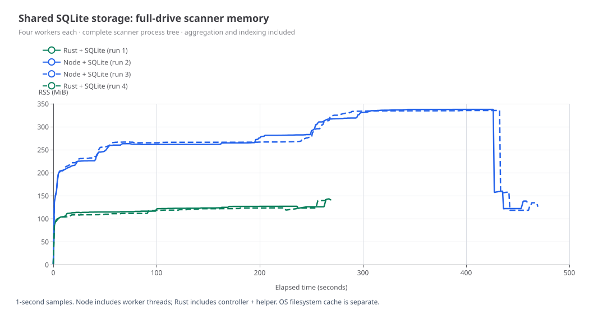

# Shared SQLite full-drive comparison

Scanned `/System/Volumes/Data` with four workers per scanner, in R4 N4 N4 R4 order.

| Run | Scanner |      Files |    Crawl | Aggregate |  Index | Finalize | End to end | Peak sampled RSS |      CPU |
| --- | ------- | ---------: | -------: | --------: | -----: | -------: | ---------: | ---------------: | -------: |
| 1   | rust    | 28,578,407 | 236.76 s |   25.50 s | 2.80 s |   2.42 s |   267.48 s |       142.97 MiB | 550.12 s |
| 2   | node    | 28,578,560 | 426.63 s |   26.66 s | 2.71 s |   2.38 s |   458.38 s |       337.69 MiB | 753.83 s |
| 3   | node    | 28,578,599 | 432.63 s |   28.64 s | 2.79 s |   3.51 s |   467.57 s |       335.36 MiB | 747.46 s |
| 4   | rust    | 28,578,837 | 224.48 s |   30.48 s | 4.96 s |   4.05 s |   263.98 s |       143.66 MiB | 518.01 s |

Mean Rust elapsed reduction: **42.60%**. Mean peak sampled RSS reduction: **57.41%**. Mean CPU reduction: **28.85%**.

All four inventories passed SQLite quick_check, independent root/direct-total checks, and final-index checks. Error-directory coverage audit:

```json
{
  "nodeFiles": 28578599,
  "rustFiles": 28578837,
  "fileDifference": 238,
  "nodeIssues": 453,
  "rustIssues": 449,
  "nodeErrorDirectories": 426,
  "rustErrorDirectories": 422,
  "matchedRustErrorDirectories": 422,
  "unreadableInBoth": 395,
  "unmatchedRustErrorDirectories": 0,
  "rustOnlyUnreadableFilesSeenByNode": 0,
  "nodeOnlyUnreadableFilesSeenByRust": 1,
  "differenceCount": 4
}
```



Caveats:

- Two repetitions per scanner, live APFS drive, no cache purge or warmup. Other activity, changing file counts and existing swap pressure limit timing precision; this is not a universal speedup or cold-cache claim.
- A short 32 MiB fixture/lifecycle regression check overlapped the beginning of run 1. Full-drive scans did not overlap; broad tests and desktop builds were deferred until the timed sequence finished.
- The final Node pass recorded four extra error directories, all ENOENT (paths disappeared between enumeration and opening). Rust later found one file in one of them. Both adjacent pairs matched all 422 Rust directories with errors; no files were hidden behind a Rust-only unreadable directory.
- Both configurations use four workers, a 512 MiB main old-space setting, topFiles=32 and identical policies. Node workers also inherit the heap setting; Rust has no V8 heap.
- End-to-end timing includes the scan API through the same SQLite rollup, indexing, final checkpoint and atomic cache publication; it excludes JSON export and independent integrity checks. Process wall time includes process startup and those checks.
- RSS is sampled once a second across the scanner process tree, including the Rust helper or Node worker threads, and the small time wrapper. Short-lived peaks may be missed; Node OS high-water RSS is also retained. OS file cache and the browser/desktop process are outside this measurement.
- Both scanners share the SQLite schema and lifecycle; Node additionally writes its pending frontier to that database, while Rust uses its bounded queue/local DFS. This compares the implemented pipelines, not isolated language runtimes.

[Raw aggregate results](shared-storage-full-drive.json) · [Memory samples](shared-storage-memory.csv)
